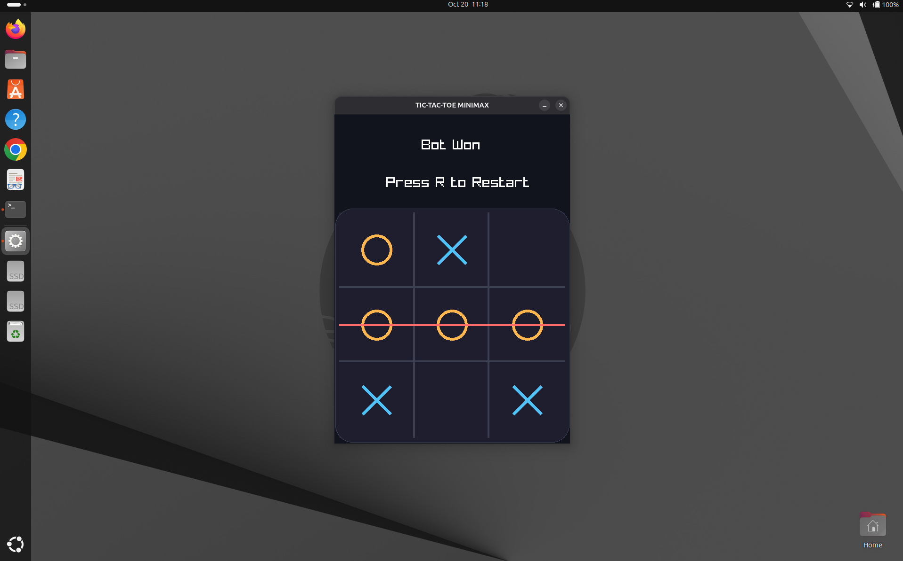

# 🎮 Tic Tac Toe Minimax

A classic **Tic Tac Toe game powered by the Minimax algorithm**, built with C and Raylib! ♟️

This project explores game development in C, graphical interfaces with Raylib, and the fundamentals of artificial intelligence through decision-making algorithms.

## 🖥️ Game Preview

Here's an overview of the game's user interface:



## ✨ Features

- 🎨 **Graphical User Interface** — A visual Tic Tac Toe game built with Raylib.
- 🧠 **Minimax AI** — An AI opponent that evaluates possible moves to find the best outcome.
- ♟️ **Move Evaluation** — The AI considers possible game states instead of choosing moves randomly.
- 🏆 **Win Detection** — Detects winning combinations on the board.
- 🤝 **Draw Detection** — Recognizes when the board is full and neither player wins.
- 💻 **Written in C** — Built to practice structured programming and algorithmic problem-solving.

## 🛠️ Built With

| Technology | Purpose |
|---|---|
| C | Core game logic and AI |
| [Raylib](https://www.raylib.com/) | Graphics and user interface |
| Minimax | AI decision-making |
| Make | Build automation |

## 📂 Project Structure

```text
tictactoe-minimax/
├── assets/
│   └── tictactoe.png
├── build/
├── external/
├── include/
│   ├── board.h
│   └── header.h
├── src/
│   ├── board.c
│   ├── main.c
│   └── minimax.c
├── .gitignore
├── .gitmodules
├── Makefile
└── README.md
```

## 🚀 Getting Started

Follow these steps to clone, build, and run the project on your machine.

### 1. Clone the repository

```bash
git clone --recurse-submodules https://github.com/AAMahadi/tictactoe-minimax.git
cd tictactoe-minimax
```

The `--recurse-submodules` option initializes and downloads the project's Git submodules.

If you already cloned the repository without this option, run:

```bash
git submodule update --init --recursive
```

### 2. Install the required tools

On Ubuntu or Debian-based Linux distributions:

```bash
sudo apt update
sudo apt install build-essential git
```

Make sure the required Raylib dependency is available as configured in the project's Makefile.

### 3. Build the project

```bash
make
```

### 4. Run the game

Use the executable path specified by your Makefile. If the Makefile provides a `run` target, you can launch the game with:

```bash
make run
```

> **Note:** Build and run targets depend on the commands defined in the Makefile. Adjust these instructions if your Makefile uses different target names.

## 🧠 How the AI Works

The project uses the **Minimax algorithm**, a classic algorithm for making decisions in two-player, turn-based games.

The algorithm explores possible future moves and evaluates game outcomes:

- 🟢 **Winning state:** A positive score for the AI.
- 🔴 **Losing state:** A negative score for the AI.
- ⚪ **Draw state:** A neutral score.

The AI alternates between maximizing its own score and minimizing the opponent's score. By evaluating possible future game states, it can choose a move that leads to the best available outcome, assuming both players play optimally.

## 🎯 Learning Goals

This project is an opportunity to practice:

- Organizing a C project using header and source files.
- Representing and updating a game board.
- Separating game logic from graphical rendering.
- Implementing recursive algorithms.
- Generating and evaluating legal moves.
- Applying Minimax to an adversarial decision-making problem.
- Managing dependencies and building a project with Make.


## 👨‍💻 Author

**Abdullah Al Mahadi**

- GitHub: [@AAMahadi](https://github.com/AAMahadi)

---

⭐ If you find this project interesting, consider giving the repository a star!

*Built with C, curiosity, and a little competitive AI. 🧠*
